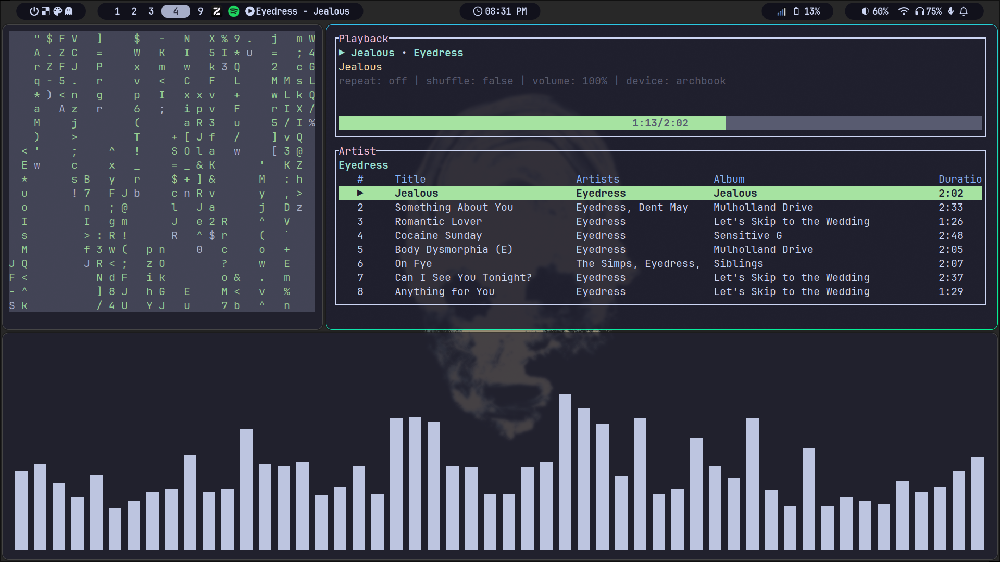
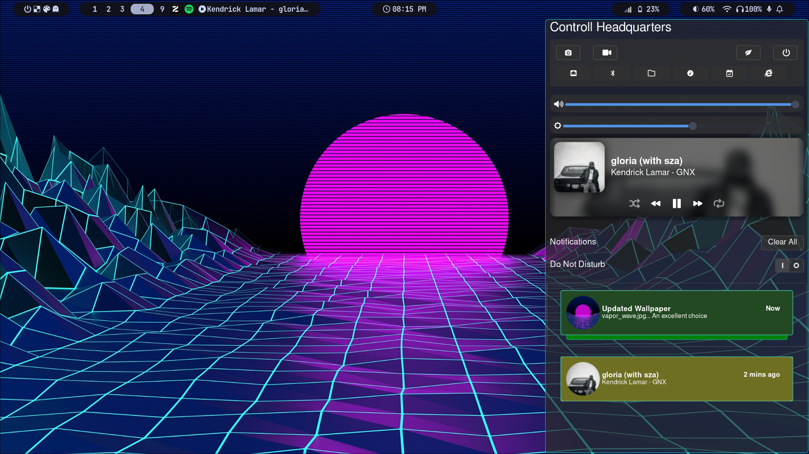
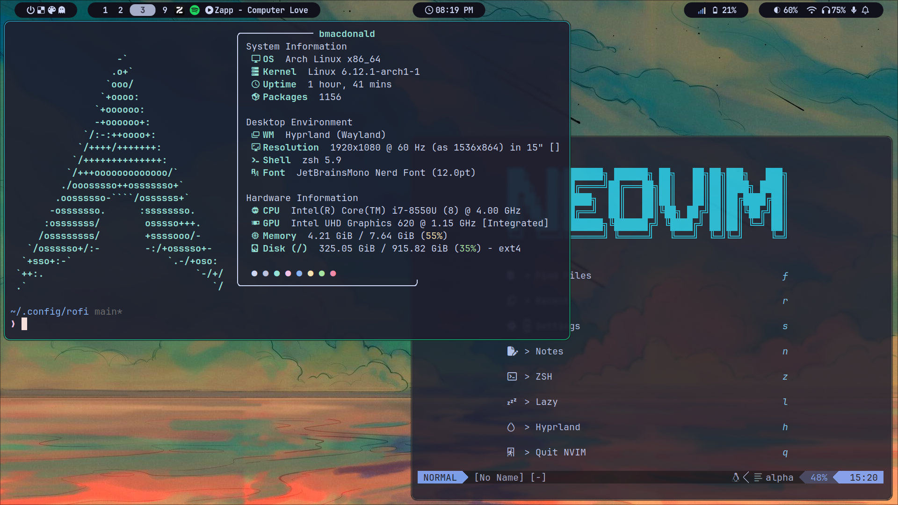

# Arch Linux Dotfiles

Check out the [Blog Post](https://bradymacdonald.com/blog/dotfiles) for more details

- [Install](#Install)
- [Packages](#Packages)
    - [Required](#Required)
    - [Optional](#Optional)
    - [AUR](#AUR)
- [Use](#Use)
- [Dark Theme](#Dark-Theme)
- [Neovim](#Neovim)

## Install

### Curl install script

Curl the install script.
It will clone repo onto your machine and other installation prompts

```bash
curl -fsSL https://raw.githubusercontent.com/Brady-MacDonald/dotfiles/main/install.sh | bash

```

### Clone Repo

Manually clone repo and run install script

```bash
git clone https://github.com/Brady-MacDonald/dotfiles.git
cd dotfiles
./install.sh
```





## Packages

### Required

Packages directly referenced in dotfiles and will error if not installed

| Package       | Purpose                |
| ------------- | ------------- |
| hyprland | Wayland compositor |
| ly | Display Manager |
| ghostty | Terminal |
| tmux | Terminal multiplexer |
| zsh | Shell |
| waybar | Status bar |
| dolphin | File explorer |
| yazi | Terminal files |
| swaync | Notification Center |
| Nerd Fonts | Terminal and system fonts |


#### Hyprland

Hyprland is the wayland compositor used
Dotfiles are built around it and its ecosystem

```bash
sudo pacman -Syu hyprland hyprpaper hyprlock hypridle hyprsunset hyprshot hyprpicker hyprcursor
```

#### Display Manager

Ly is used as the DM
Minimal TUI login screen

```bash
sudo pacman -S ly
systemctl enable ly.service
``` 

#### Terminal

Ghostty / zsh / tmux for terminal setup

```bash
sudo pacman -S ghostty tmux zsh
``` 

#### DE Info

```bash
sudo pacman -S waybar swaync
``` 

#### Bluetooth

```bash
sudo pacman -S blueman
```

- Provides:
    - `bluetooth.service` Must enable the systemd service 
    - `blueman-manager` provides a GTK based GUI

#### Media and Brightness

```bash
sudo pacman -S playerctl brightnessctl
```

#### Networking

```bash
sudo pacman -S networkmanager network-manager-applet
```

#### Audio

Pipewire is used as the audio server
Wireplumber as Session manager: `wpctl`

```bash
sudo pacman -S pipewire pipewire-pulse pipewire-jack wireplumber
systemctl --user --now enable pipewire pipewire-pulse wireplumber
```

#### Themes

Prefer to use qt GUI apps when possible
(transmission-qt, dolphin ...)

```bash
sudo pacman -S qt6ct nwg-look
```

- `qt6ct` used to control the theme of transmission and qalculate 
- `nwg-look` Used for theming GTK apps (blueman)

#### Application Launcher

Rofi is used as the dmenu replacement

```bash
sudo pacman -S rofi
```

#### Fonts

```bash
sudo pacman -S ttf-jetbrains-mono-nerd noto-fonts-emoji
```

### Optional

Packages you will probably end up installing anyway

| Package       | Purpose                |
| ------------- | ------------- |
| lazygit / lazydocker | TUI |
| ncdu | NCurses Disk Usage |
| transmission-qt | BitTorrent client |
| qalculate-qt | Calculator |
| cava | Music visualizer |
| wl-clipboard | Wayland clipboard utilities |
| signal-desktop | Messaging |

```bash
sudo pacman -S lazygit lazydocker ncdu transmission-qt qalculate-qt cava
```

```bash
sudo pacman -S wl-clipboard cliphist
```
Exposes the `wl-copy` and `wl-paste` commands
cliphist: Clipboard history manager for wayland

### AUR

Packages installed from the AUR 
Installing from AUR should be done using [yay](https://github.com/Jguer/yay)

| Package | Purpose |
| ------------- | ------------- |
| zen-browser-bin | Browser |
| spotify | Music |
| vlc-git | Because the normal repo does not work with wayland |
| spotify-terminal | TUI spotify |
| spicetify-cli | Gotta make spotify look nice |
| spicetify-themes-git | With plenty of themes |
| calcure | TUI Calendar |

```bash
yay -Syu zen-browser-bin spotify vlc-git calcure
yay -Syu spicetify-cli spicetify-themes-git
```

`spicetify config current_theme Dreary color_scheme Graytone-Blue `

## Use

`scripts/` is added to `$PATH` (via `zsh/.zshenv`) and offers various utilities.

`themes/set_theme.sh` opens a rofi picker to switch themes.

## Dark Theme

GTK and Qt apps use separate theming systems — set both up.

### GTK apps (transmission-gtk, blueman, ...)

1. Install a dark theme user-local (no root), keeping the dir name exactly as referenced:
   ```bash
   mkdir -p ~/.local/share/themes
   cp -r <path/to/Kripton-master> ~/.local/share/themes/
   ```
   GTK silently falls back to light Adwaita if the dir name does not match `gtk-theme-name`.
2. Force dark in both `~/.config/gtk-3.0/settings.ini` and `~/.config/gtk-4.0/settings.ini`:
   ```ini
   [Settings]
   gtk-theme-name = Kripton-master
   gtk-application-prefer-dark-theme = true
   ```
3. GTK4 prefers the gsettings value over `settings.ini`, so set it too:
   ```bash
   gsettings set org.gnome.desktop.interface gtk-theme Kripton-master
   gsettings set org.gnome.desktop.interface color-scheme prefer-dark
   ```

### Qt apps (transmission-qt, dolphin, qalculate)

1. `sudo pacman -S qt6ct kvantum`
2. `QT_QPA_PLATFORMTHEME=qt6ct` (already exported in `hypr/modules/env.lua`)
3. Pick the dark style, either in qt6ct GUI or in `~/.config/qt6ct/qt6ct.conf`:
   ```ini
   [Appearance]
   style = kvantum-dark
   custom_palette = true
   ```

## Neovim

Check out the [nvim-config](https://github.com/Brady-MacDonald/nvim-config.git) repo... got a nice Neovim setup
No, I do not want to add it as a submodule.
